<picture>
  <source media="(prefers-color-scheme: dark)" srcset="assets/banner-dark.png">
  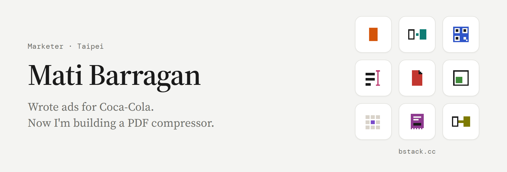
</picture>

 

I'm Mati, a marketer who can't stop making things. I spent over ten years as a creative director and copywriter at Publicis and McCann, on campaigns for Samsung and Nestlé across South America and Asia.

Today I do brand and content strategy for clients like Mirage Festival, and I build software on the side. My book, *The Waterfall Hijack*, is about how brands hijack culture. In my free time I put on events like House of Fuego.

 

##  bstack

**[bstack.cc](https://bstack.cc)** is my suite of small browser tools. Type the address and the tool is ready, with no signup. A free account keeps your work on every device.

<a href="https://bstack.cc">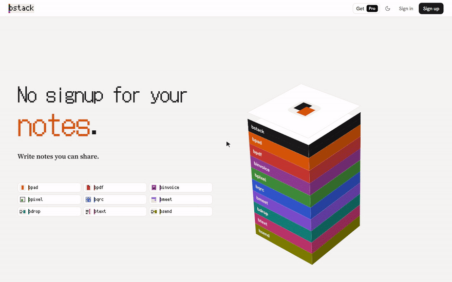</a>

###  [bpad](https://www.bpad.cc) · A notepad for whatever

<a href="https://www.bpad.cc">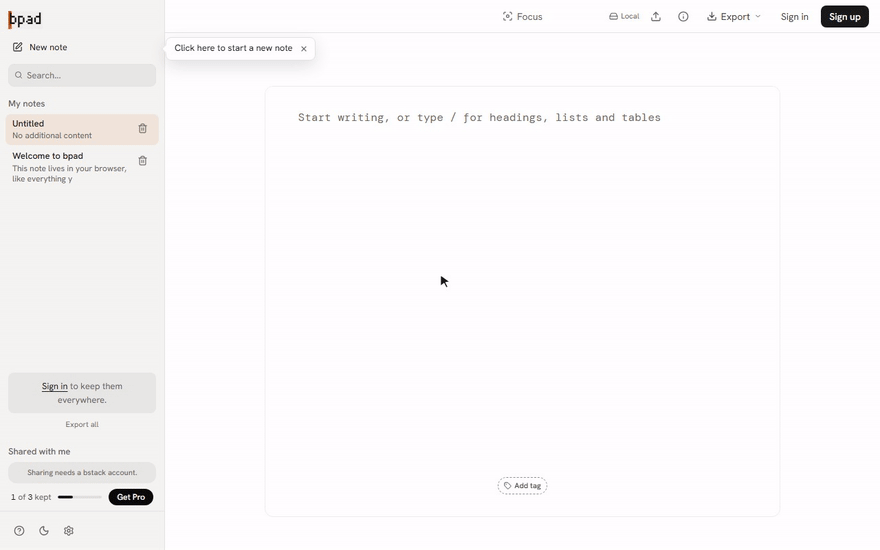</a>

###  [bdrop](https://bdrop.cc) · Phone to computer in one scan

<a href="https://bdrop.cc">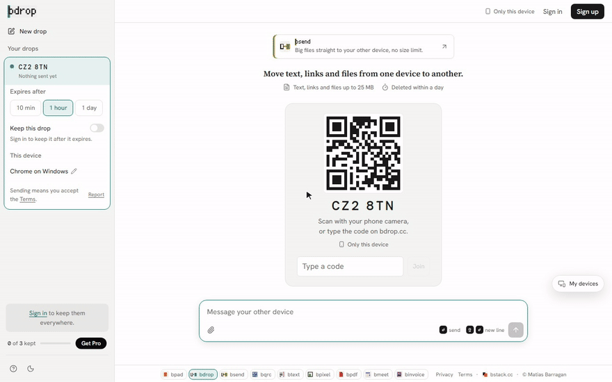</a>

###  [bqrc](https://bqrc.cc) · QR codes that never expire

<a href="https://bqrc.cc">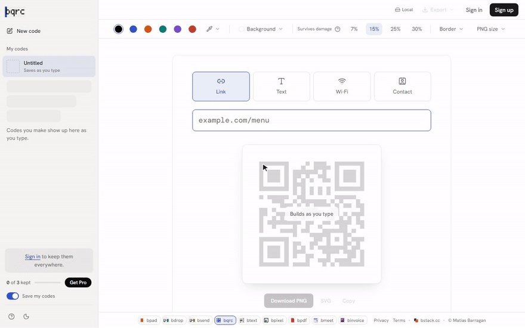</a>

###  [btext](https://btext.cc) · Count and clean any text

<a href="https://btext.cc">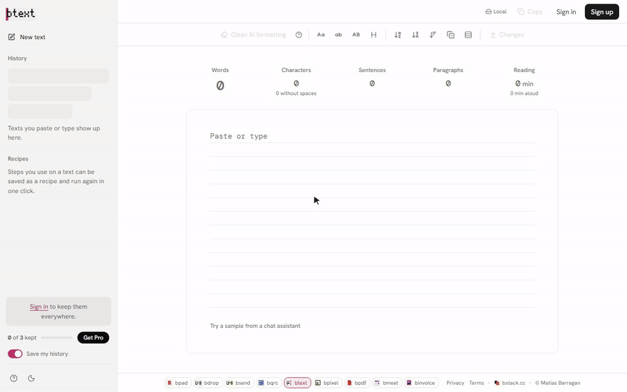</a>

###  [bpdf](https://bpdf.cc) · Compress a PDF to any size

<a href="https://bpdf.cc">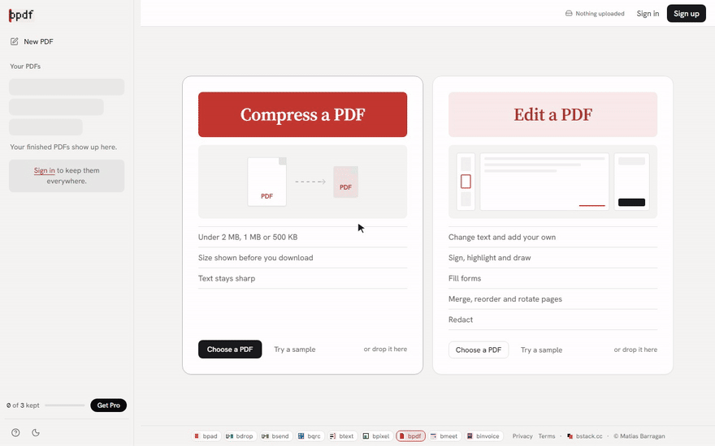</a>

###  [bpixel](https://bpixel.cc) · HEIC to JPG in your browser

<a href="https://bpixel.cc">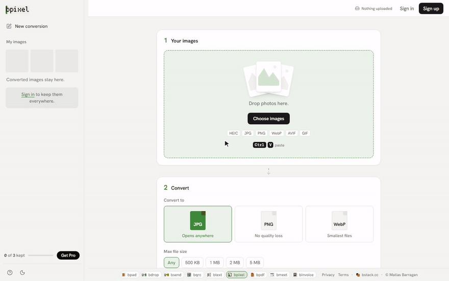</a>

###  [bmeet](https://bmeet.cc) · Find a time that works for everyone

<a href="https://bmeet.cc">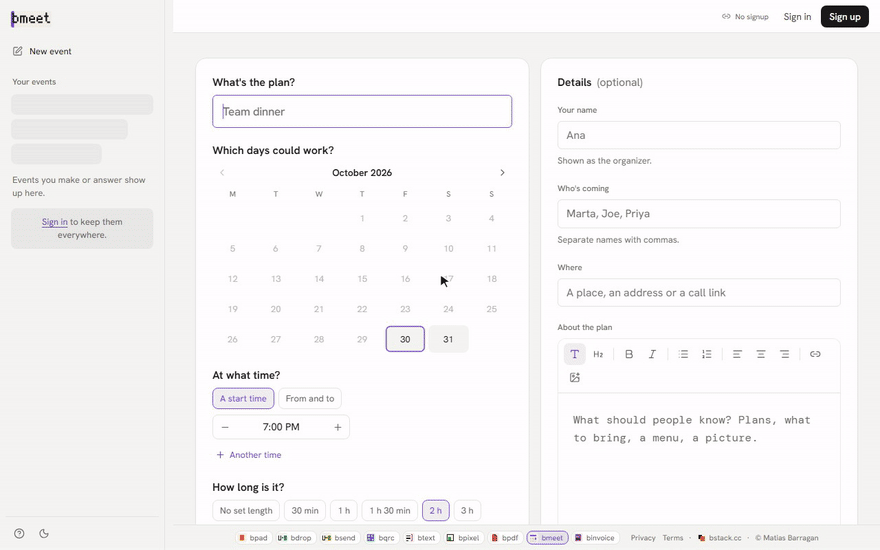</a>

###  [binvoice](https://binvoice.cc) · An invoice in 60 seconds

<a href="https://binvoice.cc">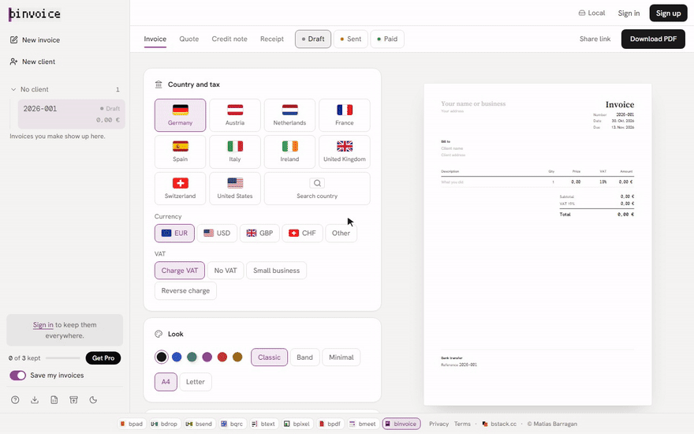</a>

###  [bsend](https://bsend.cc) · Send a file to your other device

<a href="https://bsend.cc">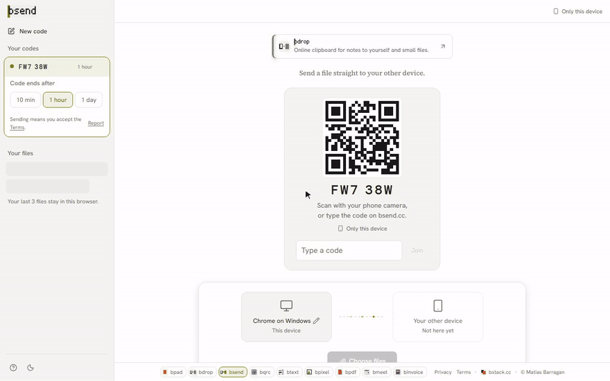</a>

 

## El Mercado

**[elmercado.com.py](https://elmercado.com.py)** is a free prediction game for Paraguay. You predict football and politics with play coins, and each month the top ten win real prizes.

<a href="https://elmercado.com.py">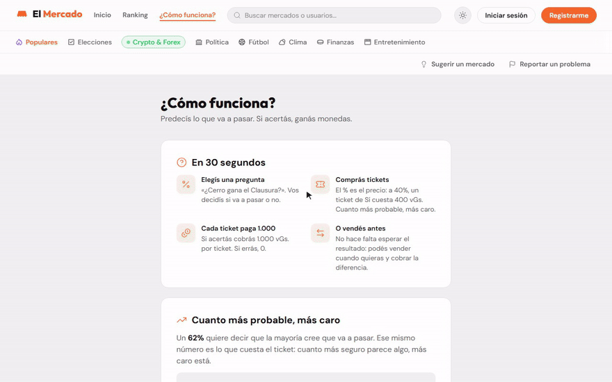</a>

 

## Say hi

[mati@barragan.com.py](mailto:mati@barragan.com.py) · [barragan.com.py](https://barragan.com.py)
